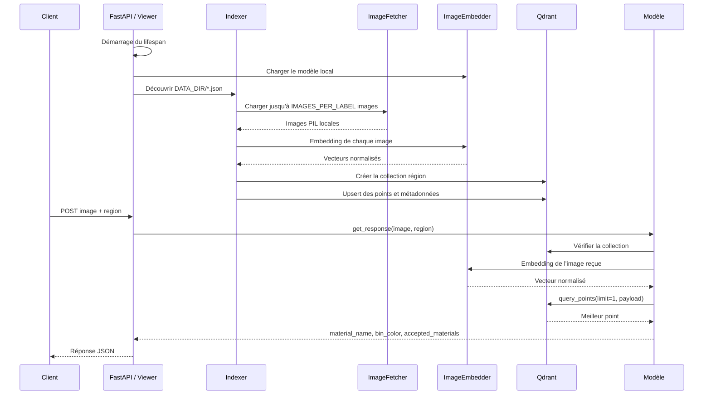
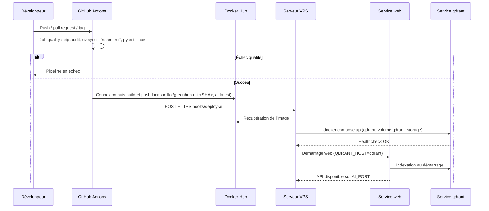

# Greener AI

Greener est une API FastAPI de classification d'images de déchets. Elle transforme les images de référence en vecteurs avec un modèle Hugging Face chargé localement, les indexe dans Qdrant par région, puis recherche le voisin le plus proche pour une image envoyée à l'API.

## Objectifs

- classifier un déchet à partir d'une image ;
- isoler les résultats par région au moyen d'une collection Qdrant par fichier JSON ;
- retourner le nom du déchet, la couleur de poubelle et, lorsqu'elle est renseignée, la liste des matériaux acceptés ;
- conserver une indexation idempotente : les points déjà présents voient leurs métadonnées actualisées sans nouvel embedding.

## Fonctionnalités

- API `multipart/form-data` pour l'envoi d'une image ;
- validation Pydantic des données de régions et du catalogue de matériaux ;
- découverte des régions dans `DATA_DIR` ;
- chargement local d'images par sous-répertoire de libellé dans `IMAGE_DIR` ;
- prise en charge des extensions `.jpg`, `.jpeg`, `.png`, `.bmp`, `.gif`, `.webp`, `.tif` et `.tiff` ;
- embeddings normalisés produits par `AutoImageProcessor` et `AutoModel` ;
- recherche Qdrant avec distance cosinus ;
- téléchargement séparé du modèle avec `download_model.py` ;
- tests unitaires, tests de schéma et test de performance marqué `performance`.

## Architecture

### Composants

| Composant | Responsabilité |
|---|---|
| `main.py` | Point d'entrée Uvicorn et route HTTP `POST /greener/upload/dechets`. |
| `viewer.py` | Application FastAPI, cycle de vie et indexation au démarrage. |
| `controller.py` | Délégation entre la vue et le modèle. |
| `model.py` | Embedding de l'image reçue, requête Qdrant et construction de la réponse. |
| `regions.py` | Découverte des JSON et validation des entrées. |
| `fetcher.py` | Indexation et lecture des images locales. |
| `embedder.py` | Chargement local du modèle Hugging Face et calcul des vecteurs. |
| `indexer.py` | Orchestration de l'indexation des régions et des libellés. |
| `repository.py` | Création de collections et opérations sur les points Qdrant. |
| `schemas.py` | Modèles Pydantic et catalogue des matériaux acceptés. |
| `configs.py` | Paramètres issus du `.env` et de l'environnement. |
| `logging_config.py` | Configuration des journaux vers la sortie standard. |
| `materials.py` | Helpers de construction des matériaux du catalogue. |

Arborescence attendue par les imports et les images Docker :

```text
.
├── main.py
├── configs.py
├── logging_config.py
├── download_model.py
├── src/
│   ├── controller.py
│   ├── embedder.py
│   ├── fetcher.py
│   ├── indexer.py
│   ├── materials.py
│   ├── model.py
│   ├── regions.py
│   ├── repository.py
│   ├── schemas.py
│   └── viewer.py
├── data/*.json
├── image_dir/<libellé>/*
├── models/<modèle>/
├── tests/ ou fichiers test_*.py
├── pyproject.toml
├── uv.lock
├── dockerfile
├── qdrant.dockerfile
└── docker-compose.yaml
```

### Données de régions et images

Chaque fichier `DATA_DIR/*.json` devient une collection dont le nom est le nom du fichier sans extension. Sa racine doit être une liste. Chaque entrée valide contient `nom`, `poubelle` et, éventuellement, `accepted_materials` :

```json
[
  {
    "nom": "Bouteille plastique",
    "poubelle": "Jaune",
    "accepted_materials": [
      {"slug": "plastique", "column": "PLST", "label": "Plastique"}
    ]
  }
]
```

Les champs supplémentaires sont refusés. Une entrée invalide est journalisée puis ignorée. `region` est ajouté à partir du nom du fichier JSON.

`IMAGE_DIR` doit contenir un sous-répertoire par libellé. Les libellés sont comparés après passage en minuscules et remplacement des caractères non alphanumériques par `_`.

### Flux de fonctionnement



## Prérequis

- Python `>=3.13` ;
- `uv` ;
- un serveur Qdrant accessible sur `QDRANT_HOST:QDRANT_PORT` ;
- accès initial à Hugging Face, sauf si le modèle est pré-téléchargé ;
- Docker et Docker Compose si le déploiement Compose est utilisé ;
- le dataset d'images, à télécharger depuis le lien indiqué dans [Installation et utilisation locale](#installation-et-utilisation-locale), ainsi que les fichiers JSON de régions.

Les dépendances déclarées sont FastAPI, Pydantic, pydantic-settings, python-dotenv, python-multipart, qdrant-client, PyTorch, TorchVision, Transformers et Uvicorn. Le groupe `dev` déclare Pillow, pip-audit, pytest, pytest-asyncio, pytest-cov, requests et Ruff.

## Installation et utilisation locale

### Téléchargement du jeu de données

Télécharger l'archive TAR du dataset depuis : <https://drive.google.com/file/d/1VuH2IHp0lqivDrCTyw7hUcUPawtd0JDd/view>. Décompresser ensuite le dataset dans `./image_dir/` à la racine du projet, afin que les sous-répertoires de libellés soient directement accessibles sous `IMAGE_DIR` (valeur par défaut : `./image_dir`). Les fichiers JSON de régions restent à placer directement dans `DATA_DIR` (valeur par défaut : `./data/`).

Depuis une arborescence conforme à la structure ci-dessus :

```bash
uv sync
python download_model.py
python main.py
```

`download_model.py` accepte `--force`. Il stocke le modèle sous `EMBEDDING_MODEL_DIR/<nom transformé>` et ne conserve que les fichiers correspondant à `*.json`, `*.safetensors` et `*.txt` lors du téléchargement. Le modèle doit être disponible localement avant l'initialisation de `ImageEmbedder`.

`main.py` lance Uvicorn avec `AI_HOST` et `AI_PORT`. L'indexation démarre dans le lifespan FastAPI, avant que l'application ne serve normalement les requêtes. Pour un lancement local, Qdrant doit donc être démarré séparément ; aucun script de lancement Qdrant local n'est fourni dans les fichiers examinés.

## Déploiement Docker Compose

Le fichier `docker-compose.yaml` définit deux services :

- `web`, construit avec `dockerfile`, publié sur `${AI_PORT}` et dépendant de l'état healthy de Qdrant ;
- `qdrant`, construit avec `qdrant.dockerfile`, avec le volume persistant `qdrant_storage`.

Le service `web` monte `./image_dir:/greener/image_dir` et `./models:/greener/models`. Le service `qdrant` monte `qdrant_storage:/qdrant/storage`.

Commande déclarée dans la documentation existante et compatible avec le fichier Compose :

```bash
docker compose up --build -d
```

Le modèle doit être présent dans le chemin local monté vers `/greener/models`, ou être préparé selon un mécanisme qui n'est pas fourni par le Dockerfile. Le Dockerfile copie `src/` et `data/`, ce qui suppose que ces chemins existent dans le dépôt.

### Déploiement décrit par les workflows



`ci.yml` s'exécute sur les pushes hors `main` et `staging`. `ci-cd.yml` s'exécute sur les pushes vers `main`/`staging`, les tags, les pull requests vers ces branches et manuellement. Dans `ci-cd.yml`, le build/push puis le déclenchement VPS nécessitent la réussite du job qualité.

## Configuration

`Settings` lit `.env` et les variables d'environnement, sans sensibilité à la casse et avec `extra="ignore"`. Les valeurs ci-dessous sont celles réellement déclarées dans `configs.py`.

| Variable | Valeur par défaut dans le code | Utilisation |
|---|---:|---|
| `AI_HOST` | `0.0.0.0` | Adresse d'écoute de `main.py`. |
| `AI_PORT` | `8000` | Port d'écoute de `main.py`. |
| `EMBEDDING_MODEL_NAME` | `facebook/dinov2-large` | Identifiant Hugging Face du modèle d'embedding. |
| `QDRANT_HOST` | `localhost` | Hôte Qdrant. Compose injecte `qdrant` dans le conteneur web. |
| `QDRANT_PORT` | `6333` | Port HTTP Qdrant. |
| `DATA_DIR` | `./data` | Répertoire des JSON de régions. |
| `DEVICE` | `cpu` | Périphérique PyTorch. |
| `IMAGE_DIR` | `./image_dir` | Racine des images de référence. |
| `LOG_LEVEL` | `INFO` | Niveau des logs. |
| `MAX_CONCURRENT_UPLOADS` | `2` | Taille du sémaphore de lecture des images. |
| `IMAGES_PER_LABEL` | `3` | Nombre maximal d'images chargées par libellé. |
| `EMBEDDING_MODEL_DIR` | `./models` | Répertoire racine des modèles locaux. |

Variables lues par les tests, avec leur défaut :

| Variable | Défaut | Contexte |
|---|---:|---|
| `PERF_BASE_URL` | `http://127.0.0.1:8000` | Client de `conftest(1).py`. |
| `PERF_LIVE` | `0` | Si égal à `1`, les tests de performance ciblent un serveur vivant. |
| `GREENER_API_URL` | `https://greenhub.lucasboillot.fr/ai/greener/upload/dechets` | Cible de `test_api_performance.py`. |

Variables utilisées par Compose ou le build Qdrant, sans défaut fourni par Compose : `QDRANT_GRPC_PORT`, `QDRANT_LOG_LEVEL` et `QDRANT_VERSION`. `qdrant.dockerfile` donne toutefois la valeur par défaut `v1.18.2` à l'argument de build `QDRANT_VERSION`. Compose transmet également `WEB_HOST` et `WEB_PORT` au conteneur web, mais l'application lit `AI_HOST` et `AI_PORT`.

Variables CI/CD : `DOCKERHUB_USERNAME`, `DOCKERHUB_TOKEN`, `VPS_DEPLOY_KEY` sont des secrets ; `DEPLOY_HOST` est une variable GitHub Actions ; `IMAGE_NAME` vaut `lucasboillot/greenhub` et `DEPLOY_SERVICE` vaut `ai` dans `ci-cd.yml`.

## API HTTP

### `POST /greener/upload/dechets`

Paramètres :

- `file` : fichier multipart obligatoire, décodable par Pillow ;
- `region` : paramètre de requête optionnel, par défaut `ile_de_france`.

Exemple :

```bash
curl -X POST 'http://localhost:8000/greener/upload/dechets?region=ile_de_france' \
  -F 'file=@chemin/vers/dechet.jpg'
```

Réponse `200` :

```json
{
  "material_name": "Bouteille plastique",
  "bin_color": "Jaune",
  "accepted_materials": [
    {"slug": "plastique", "column": "PLST", "label": "Plastique"}
  ]
}
```

`accepted_materials` peut être `null`. Le code expose aussi la documentation interactive FastAPI à `/docs` lorsqu'un serveur est disponible ; aucun autre endpoint applicatif n'est défini dans les fichiers fournis.

| Statut | Condition dans le code |
|---:|---|
| `200` | Classification réussie. |
| `400` | Le contenu envoyé n'est pas une image reconnue par Pillow. |
| `404` | La collection correspondant à `region` n'existe pas. |
| `422` | Aucun point correspondant n'est retourné par Qdrant. |

## Tests

Le groupe `dev` et `pyproject.toml` déclarent les commandes utilisées par la CI :

```bash
uv run pip-audit
uv run ruff check .
uv run pytest -v --cov
```

Le marqueur `performance` est défini dans `pyproject.toml`. Le test `test_api_performance.py` utilise par défaut une cible distante, deux images sous `data/` (`test.jpeg` et `test2.jpg`) et 100 requêtes pour le benchmark. Il peut être exécuté explicitement avec :

```bash
uv run pytest -v -m performance
```

Les deux fichiers `conftest.py` fournis ne sont pas équivalents : le fichier de 7 983 octets contient les fixtures communes et le fichier de 1 373 octets (`conftest(1).py`) contient les fixtures de performance. Le nom `conftest(1).py` n'est pas un nom automatiquement chargé par pytest comme `conftest.py`.

## CI/CD

- `ci.yml` : checkout, installation d'uv, audit `pip-audit`, synchronisation gelée, Ruff et pytest avec couverture sur les pushes hors `main` et `staging`.
- `ci-cd.yml` : même contrôle qualité sur les branches principales, tags, pull requests ciblées et déclenchement manuel ; puis construction et publication de `lucasboillot/greenhub` avec les tags `ai-<SHA court>` et `ai-latest` ; enfin appel HTTPS du hook de déploiement VPS.
- La concurrence GitHub Actions annule l'ancien run encore actif pour une même référence.

## Contribution

1. Créer une branche à partir du flux de travail du dépôt.
2. Respecter les modèles Pydantic et le catalogue de `schemas.py`.
3. Ajouter ou mettre à jour les tests concernés.
4. Exécuter localement `uv run ruff check .` et `uv run pytest -v --cov`.
5. Vérifier qu'aucun secret ou fichier de modèle n'est ajouté au dépôt.
6. Ouvrir une pull request et laisser les workflows CI effectuer les contrôles.

